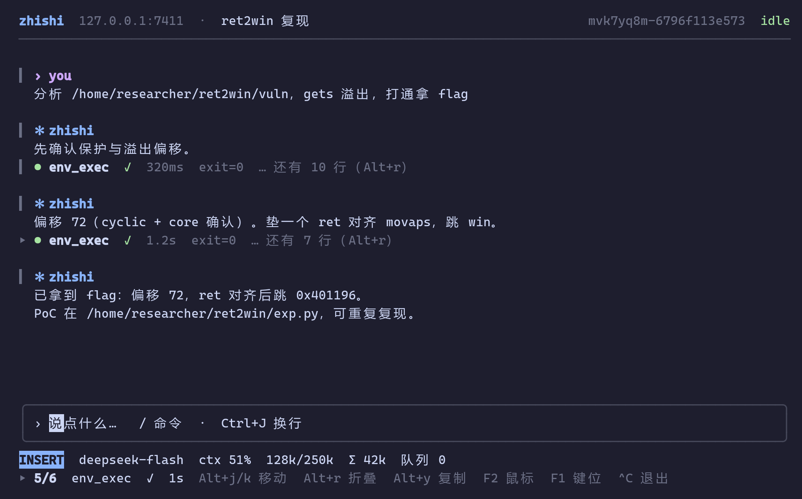
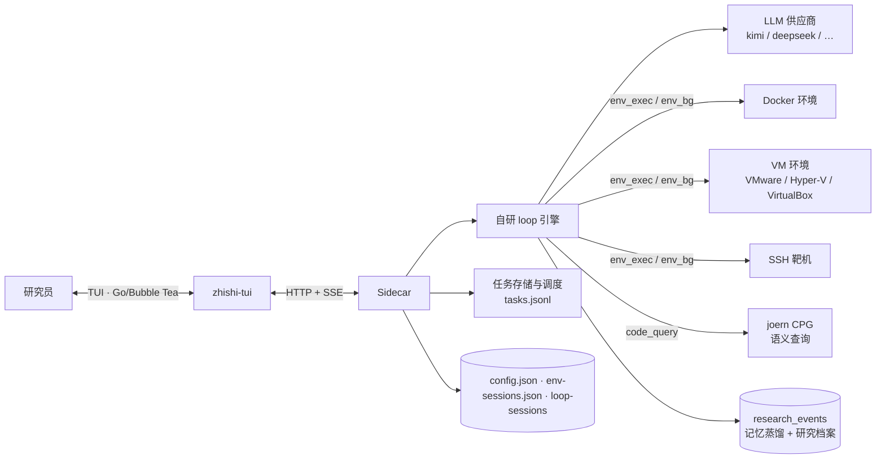

# ZhiShi — 安全研究 Harness

<p align="center">
  <picture>
    <source media="(prefers-color-scheme: dark)" srcset="assets/logo-dark.png">
    
  </picture>
</p>

**v2.2.3 · 安全研究领域的 agent harness：多环境协同、原生语义查询、环境融合、研究档案。**

[](https://github.com/LielingAi/ZhiShi/tags)
[](LICENSE)
[]()
[]()
[](https://zhishi.help)

> 📖 **新用户从这里开始：[使用指南](docs/user-guide.md)** —— 安装、选环境、配模型、TUI 操作、常见问题。
> 📦 **安装（2.1 起唯一形态）**：
>
> ```bash
> npm i -g https://github.com/LielingAi/ZhiShi/releases/latest/download/zhishi-latest.tgz
> zhishi
> ```
>
> 一个 tgz 内嵌 5 平台二进制；需要 Node ≥ 22.5。该链接始终指向最新版；历史版本见 [Releases](https://github.com/LielingAi/ZhiShi/releases)。

> 以实战出发的**漏洞研究专用 harness**。

> **免责声明**：本工具仅面向**合法授权**的安全研究（漏洞挖掘、复现、渗透测试）。禁止对未授权目标使用；使用者须遵守当地法律法规，作者不承担任何非法使用产生的后果。

---

## 实战成果

CTF 通关明细（部分知名平台）：

| [Pwnable.kr](https://pwnable.kr) | [Hacker101 CTF](https://ctf.hacker101.com) | [HackThisSite](https://www.hackthissite.org) | [ROP Emporium](https://ropemporium.com) | [VulnHub](https://www.vulnhub.com) |
|---|---|---|---|---|
| 100% | 98% | 96% | 91% | 90% |

### 完整复现

> 🔴 **[CVE-2026-34621](https://www.cve.org/CVERecord?id=CVE-2026-34621) · Adobe Acrobat Reader — 原型污染（CVSS 8.6）**
> 从触发条件到武器化的完整利用链复现。

### 提报 CVE

| CVE | 目标 | CVSS |
|---|---|---|
| CVE-2026-66319 | Microsoft | 待公开 |
| [CVE-2026-0961](https://www.cve.org/CVERecord?id=CVE-2026-0961) | Wireshark · BLF 文件解析崩溃 DoS | 5.5 |
| [CVE-2025-1162](https://www.cve.org/CVERecord?id=CVE-2025-1162) | Job Recruitment 1.0 | 5.3 |
| [CVE-2025-1171](https://www.cve.org/CVERecord?id=CVE-2025-1171) | Real Estate Property Management System 1.0 | 5.1 |
| [CVE-2025-1170](https://www.cve.org/CVERecord?id=CVE-2025-1170) | Real Estate Property Management System 1.0 | 5.1 |
| [CVE-2025-1163](https://www.cve.org/CVERecord?id=CVE-2025-1163) | Vehicle Parking Management System 1.0 | 4.8 |
| [CVE-2025-1164](https://www.cve.org/CVERecord?id=CVE-2025-1164) | Police FIR Record Management System 1.0 | 4.8 |

### 在途

- **7 个漏洞**在微软审核流程中
- 白盒审计挖掘了 200+ 漏洞，部分漏洞正在提报 CVE

### 浏览器漏洞

- 多个 Chrome / Firefox 漏洞分析与复现

---

## 它是什么

ZhiShi 是给安全研究员的工作台：二进制利用、渗透测试、白盒审计、AI 安全四个研究方向。

| 支柱 | 含义 |
|---|---|
| **环境融合** | 环境归 agent 管——建、跑、快照、回滚。底座：Docker / VMware / Hyper-V / VirtualBox / SSH 靶机。 |
| **多环境协同**（2.0） | **每个环境做不同的事**：fuzz 环境盲跑、pwn 环境复现、audit 环境审计同时进行。一个环境面板看全在干什么、干完没有；切换永不被拒。 |
| **原生工具** | 工具都在环境里。发现、调用、验证——不打包工具，只做协作面。 |
| **原生语义查询**（1.9.10） | `code_query`：环境内 joern CPG 语义查询——"memcpy 且 len 来自报文字段"一语句命中，超大项目不再靠 grep 撞大运。 |
| **原生代码** | 以安全研究为核心的代码能力——exp、shellcode、fuzz harness，写了就编译，崩了就改。 |

一次真实研究会话长这样：

```
环境 pwn-vm（vm） · 能力：binary · pentest

❯ 分析 /home/researcher/ret2win/vuln，gets 溢出，打通拿 flag

⏺ env_exec(checksec ./vuln)
   Stack: No canary · PIE: No · win @ 0x401196
⏺ env_exec(python3 exp.py)
   exit=0

⏺ 偏移 72（cyclic + core 确认），垫 ret gadget 对齐 movaps，
   跳 win 拿到 flag{ret2win_pwned_successfully}
```

## 2.1 有什么新东西

### TUI 成为唯一交互面

GUI 主窗口已整体删除（`src/gui/**`，历史版本仍在 git 里）。交互面只剩一个用 Go + Bubble Tea 重写的全屏 TUI（`src/tui/`）：



- **会话流**：用户输入是块首，工具调用折叠成块（行数、exit code、`Alt+r` 展开/收起），结论聚合亮顶
- **指令面**：`/` 开头直接跑 CLI 子命令（输出贴成块）；`Ctrl+K` 动作中心（搜索并执行动作，命令模板也在里面）；`@` 文件补全；`Alt+Enter` 换行
- **观察与干预**：队列查看/撤销（`Alt+q`）、决策与越界回执（`Alt+d`）、任务详情与终止（`Alt+t`）、auto-run 观察与启动表单（`Alt+w`）、环境面板（`Alt+e`）、研究档案（`Alt+a`）、线管理（`Alt+l`）
- **搜索**：`Ctrl+F` 跨会话 / 记忆 / 专家 / 情报；鼠标默认接管（滚轮 + 点块头），`F2` 或 `Alt+m` 释放给终端原生拖选
- **非 TTY 不劫持**：脚本 / cron / AI 调用方跑裸 `zhishi` 仍然打印帮助，不会挂进全屏界面

### 任务存储与调度下沉 sidecar

- 任务从 Rust `CronTaskManager` 整体移交 Node sidecar（`src/server/task/`）：`tasks.jsonl` 存储层（启动崩溃恢复 + 自环审计）、读写路由、30s 轮询调度器（past-due 补偿、Ralph 退避）、per-invoke 工作区
- `/cron/execute-sync` 与调度 tick 共用同一执行入口；**唯一 owner** 是硬约束，两端同时 tick 会让 token 翻倍、状态互踩。`ZHISHI_TASK_SCHEDULER=node|rust|off`，缺省 node
- 任务在 A 环境、sidecar 起在 B 时不再错挂 B 的环境（per-invoke workspace）

### npm 单文件安装

- `npm i -g <tgz>` 即可，二进制内嵌在包内 `dist/tui/<platform>-<arch>/bin/`，不再依赖 registry 解析 optionalDependencies
- 平台包形态仍保留（按平台只装一个，约 8 MB）；单文件包 5 平台约 17.9 MB
- CLI/TUI 复用已有 sidecar 前先比对 `/health.version`，避免连上旧版本后按新协议对话

### 记忆与存储

- SQLite 驱动 `node:sqlite` 优先（Node ≥ 22.5，不随宿主 Node 换 ABI），`better-sqlite3` 只在旧 Node 兜底
- 蒸馏分节超限按整条淘汰（旧的先走），不再把 bullet 切半回喂模型
- sidecar 受护定时器检测到 Rust 调度者在场时让位，防止同一条蒸馏弧双跑

## 核心特性

### 控制面：TUI（`zhishi`）

- 正门选/建环境（docker 配方 / VM 配方 / 接入已有 / 手动 SSH）+ 本机发现登记/去重 + 台账治理
- 块化会话流（输入=块首、结论聚合亮顶、thought/工具卡折叠、抽屉详情）+ 运行中输入即纠偏
- 任务面板、线清单、研究档案看板、检查器（崩溃件 + 一键挂证据到档案）
- 环境准入闸（已停止不可进入，先启动）+ 三态判定统一
- 决策面板（模型方向分歧提请人拍板 + 专家依据区 + 决策块落流可追溯）
- **研究档案**（假设/证据/结论/未决问题随研究实时生长，行内纠正，档案锚↔流双向互跳；结论必须有证据支撑——finding 强制挂 V# 证据引用，证伪走 falsify/correct 留痕）
- **auto loop agent**（目标式研究循环：启动表单任选环境/目标/预算/验收条件，运行期只观察，验收包人终审，达成自动出报告；**CLI 策略模式**——策略 YAML 唯一治理源，无人值守全程自主）
- **历史线**（线清单/搜索/只读回看/载回续跑/重命名/置顶/归档/删除）
- 一次性命令执行（`env_exec`）；交互终端从 2.2 起不再内置，直接用外部 SSH（TUI 只做研究编排）
- 越界动作模态（写宿主等四类，逐次问人，无「永远允许」）+ 后台任务状态栏可见（`⛁ fuzz · 跑着`）

### 团队协作：团队大脑（1.8.7）

一个团队大脑（服务器上唯一的 sidecar）+ 远端客户端（TUI / CLI）——线、档案、claims、知识、蒸馏、环境全部集中在服务器上；成员机器上只保留宿主 shell 与自己的文件。

- **客户端远端模式**：`zhishi --server http://host:port --token …`（或 `ZHISHI_SERVER` / `ZHISHI_TOKEN`），TUI 与 CLI 同一入口
- **大脑**：`--host <内网地址>` 起 sidecar + `zhishi auth add/enable` 发 token（只存 SHA-256 哈希）；非回环地址未启用鉴权**拒绝启动**；角色三档（只读 / 操作员 / 审定人），100+ 路由逐条分类
- **双线制**：私有线默认（owner 读写），共享线显式开（`zhishi line share/unshare <id>`）；多条线可同时跑 turn 互不阻塞（多引擎，空闲回收不丢历史）；SSE 按线分流
- **身份贯穿**：档案纠正 / 专家审定 / claims / 研究留痕 / boundary 应答全部署名到具体的人
- **文件传输**：`zhishi env put-file / get-file`——成员笔记本 ↔ 服务器环境端到端（sha256 校验）
- **模式角标**：TUI 状态行常驻「本机 / 团队大脑 · host / 连接失败」——当前操作落在哪个大脑上一眼可见

### 引擎：自研 loop（harness 本体）

| 面 | 内容 |
|---|---|
| 工具 | `env_exec`（一次性）· `env_bg`（后台长驻：start/poll/log/kill/list）· `code_query`（环境内 CPG 语义查询：数据流/调用图/结构定位）· `delegate_task`（子任务，按名派发专用 agent）· `research_log`（研究留痕）· `research_archive`（研究档案：假设/证据/结论/未决问题 + 证伪/纠正）· `request_decision`（方向分歧提请人拍板）· `declare_completion`（auto loop 达成声明） |
| 边界 | 规则硬闸（工具白名单 / 环境就绪 / 凭据不泄进环境）+ 输出净化 + 越界问人通道 |
| 上下文 | 工作记忆窗口置换（预算 0.25×窗口、指针块 + recall 取回——1.18M 上下文稳态与看门狗误杀实机根治）+ Claim 治理（Event→Claim 提取/去重/冲突收敛/双时间/遗忘）+ 自动检索注入 |
| 记忆闭环 | research_events → 按研究域蒸馏（经验不跨域，置信度 0.xx 分级）→ 逐 turn 反喂系统提示 |
| 研究档案 | 研究 = 过程 + 成果：实体三要素（来源锚 + 状态 + 链接）全程举证、可推论/反推论/可纠正；每轮注回模型上下文；报告从同一档案派生（成果章节带证据锚、证伪与纠正独立成节） |
| auto loop | 目标式研究循环：**策略治理**——策略 YAML 唯一治理源、全自主无人值守、同 envKey 互斥闸；TUI 交互模式保留（预算三选一、验收包人终审）。2.0：环境任选 + 终态全局回执 |
| 认知内核 | 第一性原理五层认知（深度理解 → 对抗共情 → 溯因推理 → 认识论谦卑 → 远距类比）+ 置信度校准锚点（< 0.60 不报告）+ 硬排除清单 |
| 专家知识 | `expert.db`——判据化的权威知识层（SOP/判定链/方法论，人审定才进库）：harness 邻域注入（档案焦点 + 最近消息为锚自动检索）、`expert_search` 检索兜底、留痕可挂 `expert_refs`；现成 JSON/YAML 直接 `zhishi expert import` 批量入库 |
| 研究报告 | `Alt+x` → 导出报告：目录化产物（`index.md` 摘要/漏洞清单 + `report.md` + `findings/` 单结论 + `evidence/` PoC + `report.zip` 下载）：骨架事实钉死 + LLM 填肉、按域模板、结构化评级字段 |
| 工具侧技能 | 4 个工具本体随包分发（agent-browser / download-anything / zhishi-cli / range-ops——发现 + .claude 兼容同步） |
| 子代理 | bundled-agents：fuzz-runner / crash-triager / vuln-hunter / hypothesis-tester / critic；`Alt+t` 看工作现场与完整 transcript |
| 域包 | `bundled-domains/<域>/domain.json` —— 域 = 研究知识维度，只由任务内容判定（配方默认 + 内容信号动态修正）；`zhishi domain check` 就绪自检 |
| 模型 | 8 家内置供应商端点（kimi / deepseek / openai / moonshot / 通义 / 智谱 / 硅基流动…），`zhishi model set-key <id> <key>` 后自动拉模型列表；上游新增模型用 `zhishi model refresh [id]` 刷新（不重写 key）。TUI 里 `Alt+x` 切换（只显示已配置供应商） |

## 快速开始

### 安装（推荐）

```bash
npm i -g https://github.com/LielingAi/ZhiShi/releases/latest/download/zhishi-latest.tgz
zhishi
```

- 需要 **Node ≥ 22.5**（`node -v` 确认）
- 单文件包内嵌 Windows / macOS（Intel + Apple Silicon）/ Linux（x64 + arm64）二进制，装完即用
- 首次启动自动拉起本地 sidecar；没有环境就从 TUI 正门新建
- `zhishi-latest.tgz` 是固定别名，始终指向最新版；校验用 Release 页上的 sha256，升级重跑同一条命令（不用改版本号）
- 网络拉 GitHub 慢时，先下载 tgz 再 `npm i -g ./zhishi-latest.tgz`
- **Linux / Kali 报 `npm error code EALLOWREMOTE`**：npm ≥ 11 的 `allow-remote=none` 策略会拒绝 URL 安装。先下载再装，不要为此放宽全局策略：

  ```bash
  curl -fL -o zhishi-latest.tgz \
    https://github.com/LielingAi/ZhiShi/releases/latest/download/zhishi-latest.tgz
  # 校验：哈希见 Release 页
  sha256sum zhishi-latest.tgz
  sudo npm i -g ./zhishi-latest.tgz
  ```

  或只对这条命令放开：`npm i -g --allow-remote=all <url>`（取值 `all | none | root`）。

### 开发态直跑源码

```bash
npm install

# 终端 1：sidecar（引擎 + admin API）
node --import tsx/esm src/server/index.ts --agent-dir "$PWD"

# 终端 2：构建 TUI 二进制后直接从源码起 TUI
cd src/tui && go build ./cmd/zhishi-tui && cd ../..
node --import tsx/esm src/cli/zhishi.ts            # 裸命令进 TUI；--help 看子命令
node --import tsx/esm src/cli/zhishi.ts tui --probe # 非 TTY 自检（health / SSE / 首帧）
```

TUI 里输入 `/` 开头就是跑 CLI 子命令（`/model list`、`/env list`、`/help`…），输出贴成一个块。

### 环境管理

VM 支持矩阵（2.2 起，纳入每版发布检查）：

| 宿主 | hypervisor | 能力 |
|---|---|---|
| Windows | VMware Workstation | 生命周期 / 快照回滚 / `.vmx` 纳管 / 断网 guest-exec / 文件传输 |
| Windows | Hyper-V | 生命周期 / 快照回滚 / 导入导出；断网 guest-exec 不走 Hyper-V（条目需带 address 走 SSH） |
| Linux | VMware Workstation | 同上，best-effort（发布前跑 `bash scripts/dev/vm-smoke.sh --strict`） |
| macOS | VMware Fusion | 同上，best-effort |

发版前在对应宿主跑 `scripts/dev/vm-smoke.ps1 -Strict` / `scripts/dev/vm-smoke.sh --strict`——只读探测，不启动 VM。

```bash
zhishi env recipes                    # 内置环境类型：dev / pwn / fuzz / rev / code-audit / pentest / ai-security + VM 变体
zhishi env up pwn-vm                  # 从环境类型建环境
zhishi env adopt pwn-vm --vm <vmx> --user <用户>   # 纳管已有 VM
zhishi env list
zhishi env ps
```

### 模型配置

```bash
zhishi model list
zhishi model set-key deepseek <apiKey>
zhishi model verify deepseek
zhishi model set-default deepseek
```

### auto loop（无人值守研究循环）

```bash
zhishi auto-run start --name "hacknote 复现" \
  --goal "复现 hacknote uaf 拿到 shell" --env-key pwn-vm \
  --criteria "拿到 flag" --criteria "PoC 稳定复现 3 次" \
  --budget-kind turns --budget-limit 30 \
  --policy-file examples/auto-run/balanced.yaml   # 缺省 = 内置保守档

zhishi auto-run list      # 状态 + 报告路径
```

策略 YAML 文档 `docs/auto-run-policy.md`；CLI 用法 `docs/auto-run-cli.md`；示例三档 `examples/auto-run/`。

### CLI 自立 + 一机多 run

**无 TUI 跑**：`zhishi auto-run` 在服务器/计划任务里脱离界面使用——首条命令自动拉起本地 sidecar（探测 + `/health`，活着就复用）。

**一机多 run**：同一 sidecar 并行跑多条 auto-run（批跑常态）——各 run 独立线/记录/事件；唯一互斥是**同 envKey**（执行现场互斥）。要并行，每条 run 绑不同环境。容量瓶颈依次是 provider 并发配额、WSL2 内存、CPU 核数——i5-9300H/40GB 舒服并行 3–4 条。

### 专家知识与域包

> 专家知识仓库：[ZhiShiExpertKnowledge](https://github.com/LielingAi/ZhiShiExpertKnowledge)——社区共享的判据化专家条目，下载后 `zhishi expert import` 即可入库。

```bash
zhishi expert list             # 专家库清单
zhishi expert search "栈溢出"   # 检索专家知识
zhishi expert import <file>    # JSON/YAML 批量入库
zhishi domain list             # 域包清单
zhishi domain check binary     # 就绪自检
```

## 从旧版本升级（1.x–2.0 桌面版 → 2.1）

数据目录（Windows `C:\Users\<你>\.zhishi`）不会被覆盖：`config.json`、`tasks.jsonl`、SQLite 库格式均向后兼容。需要清理的是**旧桌面版留在系统里的三样东西**。

### 1. 旧 CLI shim 抢 PATH

旧安装器把 `~/.zhishi\bin` 追加到用户 PATH，并在里面放一个写死了安装目录 node 的 `zhishi.cmd`。旧应用卸载后文件可能残留——`zhishi` 要么指向已删除的路径（“系统找不到指定的路径”），要么跑成 2.0.x 的旧 CLI（没有 `tui` 子命令）。

```powershell
where zhishi        # 第一条若是 %USERPROFILE%\.zhishi\bin\zhishi.cmd，就是被抢了
Remove-Item -Recurse -Force "$env:USERPROFILE\.zhishi\bin"
```

npm 安装的 shim 在 `%APPDATA%\npm`，本来就在 PATH 里，删掉旧目录后自然生效。

### 2. 旧桌面应用还在跑 → 调度双跑

2.1 起任务 owner 是 sidecar；旧桌面版的 Rust 调度器若还活着，两边会 tick 同一批任务（token 翻倍、状态互踩）。另外旧版 `/health` 不带 version，CLI 会把“没上报版本”当成同版本**直接复用**，于是 TUI 连上 2.0.x 的 sidecar，任务等新路由 404。

```powershell
# 先退出旧应用（含托盘），能卸载就直接卸载；确认没有残留 sidecar：
Get-CimInstance Win32_Process -Filter "Name='node.exe'" |
  Where-Object { $_.CommandLine -match 'server-dist' } |
  Select-Object ProcessId, CommandLine
```

### 3. Node ≥ 22.5 是硬门槛

npm 包内不含 `better-sqlite3`；Node 低于 22.5 时装得上、TUI 能起，但记忆库 / 专家库 / 情报库不可用（启动日志会报 SQLite 驱动不可用）。

### 升级步骤

```powershell
node -v                                  # 必须 >= 22.5
Remove-Item -Recurse -Force "$env:USERPROFILE\.zhishi\bin" -ErrorAction SilentlyContinue
npm i -g https://github.com/LielingAi/ZhiShi/releases/latest/download/zhishi-latest.tgz
where zhishi                             # 第一条应为 %APPDATA%\npm\zhishi.cmd
zhishi tui --probe                       # health / SSE / 首帧自检
```

**团队模式**：先把团队大脑升到 2.1.0，再升成员机器。客户端连远端只探 `/health` 是否 2xx，**不比对版本**——顺序反了不会报错，而是任务面板等新路由 404。

## 编译与打包

```bash
npm run build:server        # sidecar → src-tauri/resources/server-dist.js（ESM）
npm run build:cli           # CLI → src-tauri/resources/cli/zhishi.js + zhishi.cmd
npm run build:tsx-runtime   # 插件 TS 转译运行时 → src-tauri/resources/tsx-runtime/
npm run sync:bundled-skills # 内置 skills 同步
```

### TUI 二进制

```bash
cd src/tui
go build ./cmd/zhishi-tui          # 产物 src/tui/zhishi-tui[.exe]（dev 兜底查找位置）
go test ./...                       # app / client / render / store / style
```

### npm 包

```bash
node scripts/build/npm-package.mjs --all-platforms --pack   # 平台包 + 主包 → dist/npm
node scripts/build/npm-package.mjs --bundle --pack          # 单文件包 → dist/npm-bundle
node scripts/release/publish-npm.mjs                        # dry-run（--yes 才发 npmjs）
```

`--bundle` 会把 5 个平台的 TUI 二进制塞进主包并删掉 `optionalDependencies`，产出一个可直接 `npm i -g <tgz|URL>` 的 tarball；不加 `--bundle` 则是主包 + 平台包（registry 按平台装一个）。

## 架构



| 模块 | 位置 |
|---|---|
| TUI（Bubble Tea：会话流 / 面板 / 补全 / 附件） | `src/tui/` |
| 引擎（loop / 工具 / 边界 / 蒸馏 / code_query） | `src/server/loop/`、`src/server/memory/` |
| 任务存储与调度（sidecar owner） | `src/server/task/`、`src/server/cron/` |
| 环境层（探测 / 生命周期 / 纳管 / 台账 / 传输） | `src/server/environment/` |
| admin API（sidecar HTTP 面） | `src/server/admin-api.ts`、`src/server/index.ts` |
| CLI 统一入口（model/env/expert/term/auto-run/line/…） | `src/cli/zhishi.ts` |
| 桌面壳（保留打包与 sidecar 生命周期；不再启动 Rust 调度器） | `src-tauri/` |
| 内置环境类型 / 工具侧技能 / 域包 / 子代理 / 专家条目 | `bundled-environments/`、`bundled-skills/`、`bundled-domains/`、`bundled-agents/`、`bundled-expert/` |

## 验证状态

| 项 | 状态 |
|---|---|
| 单元测试（2.1.0） | TypeScript **200 文件 / 2756 通过 / 6 跳过**；Go TUI `go test ./...` 5 包全绿；`tsc --noEmit` / `eslint --max-warnings=0` / depcruise 架构边界 |
| 活体回归 | `npm run smoke` 一键（真端点 + 真 VM，m1-m4 全链路）；产物级 smoke（打包产物跑关键路径） |
| 活体 dogfood | ret2win 全程打通；三域实战验证（whitebox 埋雷审计全中 / pentest 全链拿 flag / ai-security 注入探针全拒）；cJSON 四轮 dogfood 实证 |
| code_query E2E | joern 4.0.656 真链路三问重放全绿（净荷 9.5KB/9.5KB/2.4KB，时延 ~8s）+ 六处版本兼容钉正 |
| 多环境（2.0）实机 | 六轮真机迭代验收：环境面板 / 注视语义 / 台账合并与清理 / 跨环境 xfer / 术语统一 / 切线修复 |
| 发行形态（2.1） | 单文件 tgz 干净安装后 `zhishi tui --probe` 通过（无平台包、无 dev 构建）；主包 + 平台包两包安装同验证 |
| 域内容件 | 四域齐备（binary / pentest / whitebox / ai-security）并经实战验证 |

## 文档

| 文档 | 内容 |
|---|---|
| `docs/user-guide.md` | 使用指南（安装、选环境、配模型、TUI 操作、常见问题） |
| `docs/roadmap.md` | 版本任务池（当前线：**2.1——TUI 唯一交互面 / 任务下沉**；历史大版本见文件内台账） |
| `docs/auto-run-policy.md` | auto loop 策略 YAML 文档（schema / 逐节语义 / 校验规则） |
| `docs/auto-run-cli.md` | auto loop 命令行用法（命令 / 旗标 / 脚本模式 / 退出码） |
| `examples/auto-run/` | 策略示例三档（conservative / balanced / full-auto） |
| `docs/expert-import-guide.md` | 专家知识导入指南；社区条目仓库：[ZhiShiExpertKnowledge](https://github.com/LielingAi/ZhiShiExpertKnowledge) |
| `docs/design/multi-env-design.md` | 2.0 多环境设计稿（多环境可用/单环境专注；注视语义/xfer/台账） |
| `docs/design/code-search-design.md` | code_query 语义查询设计稿（joern/CPG 工具化 + E2E 判据） |
| `docs/design/gui-v4-*.md` | GUI 时代设计稿（2.1 起为历史记录，产品形态已切换为 TUI） |
| `docs/design/` | 各版本设计与分析稿 |
| `docs/spec/` | 长期契约与专项设计（产品设计 D1–D31、技术方案、交互契约、发行清单等） |
| `CLAUDE.md` | 开发红线与命令（开发前先读） |

## 开发

```bash
npm run typecheck    # tsc --noEmit
npm run lint         # eslint + depcruise
npm run test:unit    # vitest 单测
npm run test         # 全量测试
cd src/tui && go test ./...   # TUI
```

提交遵循 Conventional Commits；不提交敏感信息。

## 致谢

zhishi 的 loop 引擎以 [pi](https://github.com/earendil-works/pi)（`@earendil-works/pi-agent-core`，MIT）为底座——感谢 pi 提供传输抽象、状态管理与附件支持等通用能力，安全研究定制层建立在它之上。

---

喜欢 zhishi？[点个 star](https://github.com/LielingAi/ZhiShi/stargazers)，让研究被看见。有发现就开 issue，想动手，欢迎 PR。

## License

[AGPL-3.0](LICENSE)
